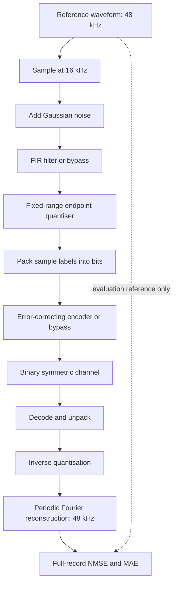
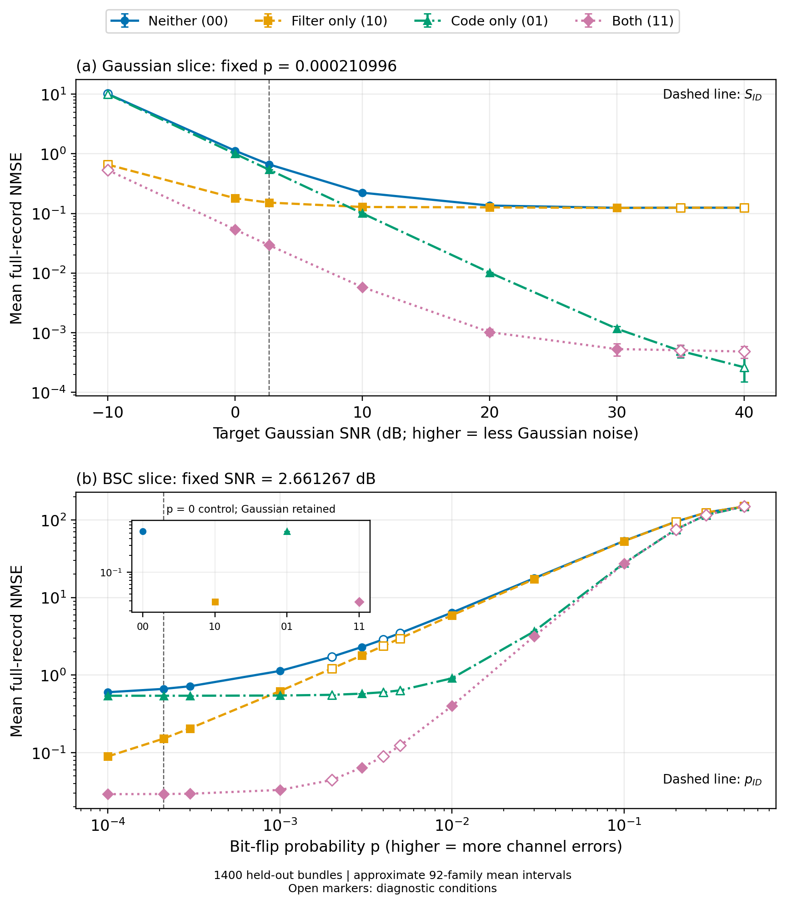

# Digital Signal Transmission

An end-to-end Python investigation of sampling, noise reduction, finite-bit quantisation, error-correcting codes and signal reconstruction.

**Author: Lifeng Wang**

This project follows a real-valued waveform through an explicitly modelled digital transmission system, measures where information is lost, and tests which design changes improve reconstruction under different channel conditions and bit-rate budgets. It includes the implementation, experiment protocols, complete measured CSV results, figures, technical report and reproduction tools.

[Technical report](report/main.pdf) · [Architecture](docs/ARCHITECTURE.md) · [Experiments](docs/EXPERIMENTS.md) · [Reproduction](docs/REPRODUCIBILITY.md) · [Data and references](NOTICE.md)

## Background and motivation

A transmission system can recover every sampled label and still reconstruct the wrong source. Sampling can discard a frequency before any bits are sent. Quantisation introduces a finite codebook. Noise reduction can suppress unwanted energy while distorting the desired waveform. Redundancy can protect individual codewords, but it increases traffic, and a high probability of correcting one block does not necessarily imply a high probability of recovering a complete record perfectly.

This project studies those effects together. The aim is to connect familiar DSP and communication algorithms to measurable system behaviour, rather than judge each block in isolation.

The investigation asks:

1. What sample rate preserves the reference, and what fails when the rate is too low?
2. When does a multiband FIR improve reconstruction, and when does its distortion outweigh noise reduction?
3. How much quantiser resolution is justified by a measured error budget?
4. Which error-correcting code suits the chosen bit layout and channel conditions?
5. How do filtering and coding interact in the complete receiver?
6. What changes under an objective of lower waveform error or a fixed transmitted-bit-rate cap?

The experiments use an externally supplied, deterministic two-second multitone reference. All stochastic channels are simulated. Conclusions are conditional on this signal, the tested channel models and the declared design objectives.

## System overview



The receiver receives bits and public configuration parameters. It never receives the clean reference, actual Gaussian noise vector or true bit-flip mask. Those quantities are restricted to evaluation.

| Baseline component | Configuration |
|---|---|
| Reference | 96,000 mono samples, 48 kHz, 2 s |
| Reference power | 0.73 in the original NPY amplitude units |
| Spectral components | 440, 1320, 2200 and 6000 Hz |
| Transmission sampling | 16 kHz, preserving all four components |
| Gaussian anchor | Target SNR approximately 2.661267333 dB |
| FIR | 385 taps, symmetric Hann window, four bands with 70 Hz half-width |
| Quantiser | 14 bits, fixed half-range 18, endpoint codebook |
| Bit layout | Unsigned, sample-major, most significant bit first |
| Baseline code | Systematic Hamming(7,4), single-error correction |
| BSC anchor | Independent flip probability approximately 0.000210995693191 |
| Reconstruction | Periodic Fourier interpolation to the original 48 kHz grid |
| Baseline logical traffic | 784,000 transmitted bits per 2 s record; 392 kbit/s |

The anchor severities come from explicitly registered parameter draws. They are reproducible project settings, not estimates of real-world channel frequencies.

## Step 1: understand the signal and select a sample rate

Input checks establish the NPY/WAV hashes, dimensions and exact PCM relationship. Numerical experiments use the NPY values without renormalising them; the WAV supplies an audible representation.

FFT analysis measures spectral components, coherent amplitudes, finite-record power and window effects. Parseval consistency, inverse-transform round trips and controlled analytic examples check the implementation. The two-second duration gives 0.5 Hz native bin spacing.

Sampling at 16 kHz preserves the measured 6 kHz highest component while reducing the number of transmitted sample labels by two thirds relative to the reference grid. The deliberately insufficient 8 kHz case demonstrates aliasing: the 6 kHz component folds to 2 kHz. Matching the resulting observed samples cannot identify the original high-frequency source uniquely.

The sampling analysis therefore distinguishes a successful numerical interpolation from preservation of the information needed to reconstruct the source.

## Step 2: design and validate the FIR

Independent Gaussian noise is added after sampling. Its model variance is the sampled signal power divided by the requested linear SNR. Each finite vector is used as drawn; its realised mean and power are not adjusted to force an exact finite-record SNR.

The filter exploits the gaps between the four known tones. Candidate multiband FIRs are evaluated on design data. FFT convolution is checked against direct linear convolution; sufficient zero padding prevents circular wraparound, and an explicit centre crop compensates the filter delay.

The parameter study evaluates **372 candidates**. The selected 385-tap Hann design is then evaluated using **400 held-out noise records**. Observations used to select the filter are not counted as new validation evidence.

Filtering reduces broad-band noise but introduces waveform distortion. At high Gaussian SNR, that distortion can become more important than the removed noise. This limitation is measured rather than hidden behind an average improvement.

## Step 3: quantise, pack and protect the samples

The quantiser clips to `[-18, 18]`, maps to `2**B` endpoint levels and uses a documented epsilon shift and NumPy rounding convention. Its level spacing is `2*A/(2**B - 1)`, which differs from the common idealised `2*A/2**B` model.

A bit-depth scan measures SQNR, overloads and reconstructed error. Fourteen bits is selected using a predeclared 1% quantisation-component budget across the design records and both filter settings. This tolerance is a design preference, not a universal perceptual threshold.

Labels are packed in a deterministic bit order. Hamming(7,4), Hamming(15,11), repetition(5,1) and uncoded transmission are compared. Generator and parity-check matrices, syndrome decoding, error patterns, padding and true-information-bit recovery are checked explicitly.

The binary symmetric channel flips transmitted bits independently. Coding is assessed through bit errors, complete payload recovery and reconstructed waveform error. These answer different questions: a partially damaged payload may still have acceptable average waveform fidelity, while one incorrect high-significance label bit can have a large amplitude effect.

## Step 4: compare complete configurations

The main study switches filtering and coding independently:

| Configuration | FIR | Hamming(7,4) |
|---|---|---|
| Neither | Off | Off |
| Filter only | On | Off |
| Code only | Off | On |
| Both | On | On |

The held-out study uses **1,400 independent complete-record bundles**, **22 unique severity conditions** and **123,200 transmission paths**. Two slices vary Gaussian SNR at the fixed anchor BSC probability, and BSC probability at the fixed anchor Gaussian SNR. They do not constitute a measured full two-dimensional response surface.

Each bundle shares the relevant contaminated input across paired configurations. Independent repeats use distinct random leaves. Measurement and uncertainty calculations operate on complete records, rather than treating individual samples as independent observations.

The primary metric is full-grid normalised mean squared error:

$$\mathrm{NMSE}=\frac{\frac{1}{N}\sum_n(\hat{x}[n]-u[n])^2}{\frac{1}{N}\sum_n u[n]^2}.$$

All 96,000 reference positions enter the comparison. There is no amplitude fitting, alignment optimisation or endpoint trimming. MAE supplies an alternative view of fidelity; deterministic examples demonstrate how it can rank sparse and diffuse errors differently from NMSE.

## Step 5: test alternatives and impose a rate cap

A separate study changes one design decision at a time: filter bandwidth, tap count, quantiser width or channel code. Twenty pilot bundles plan **350 new confirmation bundles**. Nine variants at 15 conditions give **47,250 confirmation paths**. Twelve equally weighted main conditions define the objective; three diagnostic conditions have zero objective weight.

The constrained-rate study reuses a prespecified anchor subset of those confirmation records. It imposes a logical **320 kbit/s** cap while retaining the selected sample rate, quantiser range and waveform-quality rule. Exact bit accounting includes padding in the last codeword.

## Results and tradeoffs

| Question | Measured conclusion |
|---|---|
| Best baseline configuration at the anchor? | Filtering and Hamming(7,4) together give mean NMSE approximately **0.029339**, the lowest of the four configurations. |
| Is the FIR always beneficial? | Gaussian-only checks at 35/40 dB expose filter distortion. Some high-SNR end-to-end contrasts remain unresolved. |
| What improves the original main-domain objective? | Increasing to 16 bits is the tested feasible change with a positive adjusted objective-gain interval. Traffic rises from **392 to 448 kbit/s**, with unresolved anchor-point benefit. |
| What fits the 320 kbit/s scenario? | Hamming(15,11) meets the declared anchor mean-quality rule at **305.46 kbit/s**, with lower exact-payload reliability than the baseline. |
| Is the planned precision achieved everywhere? | Seven of the 92 main-study means miss the planned 5% relative interval half-width target; the maximum is about **42.43%**. |

Intervals use the declared statistic families and approximate t/CLT arguments. They describe uncertainty in mean performance, not guarantees for individual records. Negative, unresolved and diagnostic results remain part of the analysis.



The [technical report](report/main.pdf) contains full tables, derivations, confidence-interval definitions and limitations. The [experiment guide](docs/EXPERIMENTS.md) maps results to their source modules and CSV files.

## Getting started

Exact replay uses **64-bit Windows, Python 3.13.5, NumPy 2.1.3, SciPy 1.15.3 and Matplotlib 3.10.0**. The explicit Conda lock records native and rendering dependencies as well.

```bash
git clone https://github.com/LIfengWang666/digital-signal-transmission.git
cd digital-signal-transmission
conda create -n signal-transmission --file conda-win-64-explicit.txt
conda activate signal-transmission
```

Check the included scientific artifacts without running the experiments:

```bash
python -m reproduction.check_reproducibility
```

Regenerate all numerical studies, figures and report fragments:

```bash
python run_all.py --data-only
```

Regenerate everything and compile the report with an installed **Tectonic 0.17.0** executable:

```bash
python run_all.py --tectonic "C:/Tools/tectonic/tectonic.exe"
```

If `tectonic` is on `PATH`, `python run_all.py` is sufficient. Compile the saved report inputs alone with:

```bash
python -m reproduction.build_pdf --tectonic "C:/Tools/tectonic/tectonic.exe" --report report
```

The full workflow is computationally substantial because independent checks replay numerical paths as well as recomputing summaries. Large studies use six worker processes by default. Add `--r4-workers 1 --r5-workers 1` for serial execution. The FIR parameter scan separately uses its recorded four-thread BLAS setting.

Use a disposable clone if you want to retain the included measurements for comparison. Do not change frozen targets to make a failed comparison pass. The [reproduction guide](docs/REPRODUCIBILITY.md) explains the comparison rules and common problems.

## Repository structure

```text
run_all.py             Ordered pipeline and optional report compilation
degradation.py         Gaussian-noise and binary-symmetric-channel models
reference_signal.*     Numerical reference and matching audio representation
stage1/                Spectral analysis, sampling and aliasing
stage2/                FIR approach, parameter search and held-out validation
stage3/                Quantisation, bit packing, coding and reliability
stage4/                Metrics, experiment planning and complete-system study
stage5/                Counterfactuals, constrained rates and packing analysis
stage6/                Scientific target inventory, environment and run evidence
reproduction/          Independent checks, figure exporters and PDF builders
report/                Technical report, LaTeX, bibliography, figures and tables
metadata/              Input checks and explicit random-stream registry
docs/                  Architecture, experiment and reproduction guides
```

Labels such as `r11` and `r43` are stable internal experiment identifiers. Descriptive filenames and the experiment map provide navigation through the implementation.

Complete measured outputs are included, including large trial CSV files and seed manifests. This makes the repository larger than a source-only example, but allows results to be inspected without first running the whole simulation. Temporary execution caches, Python bytecode and TeX auxiliaries are excluded from version control.

## Reproducibility design

- A fixed `SeedSequence`/PCG64 registry separates parameter draws, Gaussian vectors and BSC masks. Explicit study, phase, condition, repeat and layout paths make replay independent of worker scheduling.
- Design and held-out validation use different leaves. Paired methods intentionally share contaminated records; replaying a leaf creates no new observation.
- Input hashes and the exact NPY-to-PCM relationship are checked before numerical work.
- Scientific targets cover exact CSV values, arrays, payloads and generated table text. Raster checks compare exact pixels. SVG checks preserve visible content while excluding nonvisual metadata and opaque identifier names.
- Independent implementations cross-check convolution, reconstruction, quantisation, decoding, summaries and exact payload probabilities.
- This release packages the existing validated measurements. Publication checks and report compilation do not constitute a new full numerical replay. Verification on a second machine is not claimed.

## Scope and limitations

This is a finite-record simulation with known spectral structure, a fixed quantiser range and a periodic reconstruction assumption. It does not model synchronisation acquisition, a physical radio front end, burst errors, protected transport headers, hardware energy or real-time latency. Bit-rate figures count logical transmitted bits.

The design objective weights tested conditions equally; it is not an empirical distribution of channel usage. Code choice under the anchor rate cap does not replace the baseline choice for every severity condition. Extending conclusions to speech, nonperiodic inputs or correlated channels requires new experiments.

## Technical references and data

Published work on sampling, the FFT, windowing, quantisation, Hamming codes and statistical inference remains attributed in [the bibliography](report/references.bib).

Primary documentation includes [NumPy FFT conventions](https://numpy.org/doc/2.1/reference/routines.fft.html), [NumPy parallel random streams](https://numpy.org/doc/2.1/reference/random/parallel.html), [SciPy Fourier resampling](https://docs.scipy.org/doc/scipy-1.15.3/reference/generated/scipy.signal.resample.html) and [NIST confidence limits for a mean](https://www.itl.nist.gov/div898/handbook/eda/section3/eda352.htm).

[NOTICE.md](NOTICE.md) records input provenance and distinguishes the implementation from the externally supplied reference waveform.
